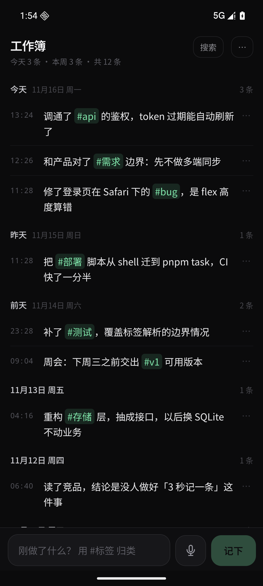
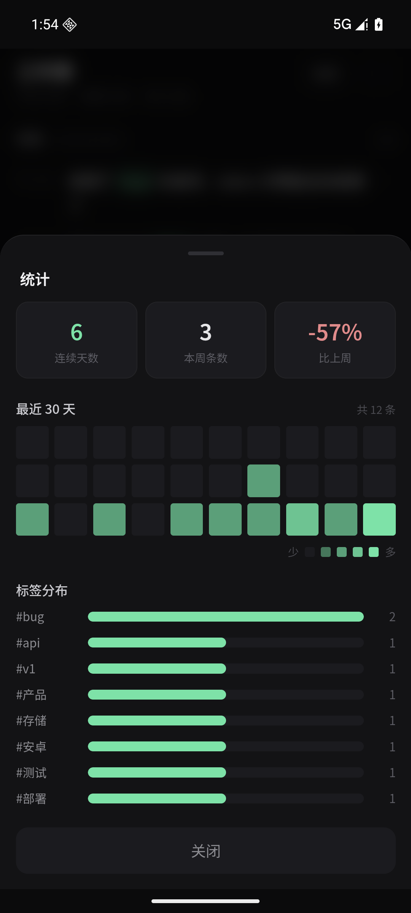
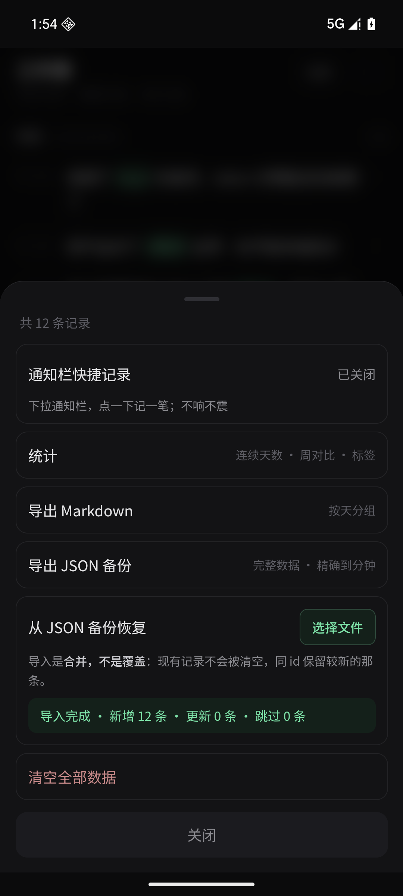

<div align="center">

# 工作簿 · Worklog

**拿起手机、打一句、回车。3 秒把刚做的事记下来。**

不做项目管理，不做打卡 KPI，不做积分养成。<br>
只解决一件事：让你在想记的那一秒，记录不被界面耽误。


</div>

<p align="center">
  
  
  
</p>

<p align="center">
  <sub>左：时间线（#标签 行内高亮、按天分组）　中：统计（连续天数 / 热力图 / 标签分布）　右：菜单</sub>
</p>

---

## 为什么不写进备忘录

备忘录能打字，但它不为你「回看」和「汇总」服务；todo 类 App 又要你先建任务、选项目、定截止时间——记录前先做十秒决策，那三秒就没了。

工作簿的取舍是反过来的：

| 常见做法 | 这里怎么做 |
| --- | --- |
| 先建列表 / 建项目 | 没有列表，只有一个输入框，打开即聚焦 |
| 选分类、拖标签 | 正文里写 `#标签`，边打边归类，不写也行 |
| 完成状态、进度、积分 | 一律没有。记录不是任务，不需要收尾 |
| 云端账号、多端同步 | 数据只在本机 IndexedDB，无账号、无服务端 |
| 富文本、附件、封面 | 一行纯文本。要展开全靠标签和时间 |

## 它现在能做什么

**记录**

- 打开即输入态：启动直接聚焦输入框，回车提交
- 行内 `#标签`：自动识别、高亮、点击即筛选，写入时已归一化
- 桌面小部件 2×1：点一下直达输入态，键盘自动弹起
- 通知栏快捷记录：常驻静音通知，点通知或「记一笔」按钮直达输入态（[docs/NOTIFICATION.md](docs/NOTIFICATION.md)）
- 语音输入：说一句落到输入框，人工改完再提交（[docs/VOICE.md](docs/VOICE.md)）

**回看**

- 时间线按天分组（今天 / 昨天 / 前天 / 具体日期）
- 搜索正文与标签；标签点一下就筛
- 顶部实时统计：今天 / 本周 / 总计
- 统计面板：连续记录天数、本周 vs 上周、最近 30 天热力图、标签分布

**收拾数据**

- 点条目展开：编辑 / 复制 / 删除，删除有二次确认 + 5 秒撤销
- 导出 Markdown（按天分组，直接贴周报）与 JSON 备份（文件名精确到分钟）
- 从 JSON 备份恢复：**合并**而非覆盖，同 id 保留 `updatedAt` 较新的那条

**装得上**

- 安卓真 APK（Capacitor，minSdk 24 / targetSdk 36，release 签名 + minify）
- 浏览器可装成 PWA，断网可用（Service Worker 预缓存）

## 安装

**安卓**：从 [Releases](../../releases) 下载 APK 直装；或本地构建：

```bash
./scripts/build-apk.sh        # debug 包 + 自动装到已连接的设备
./scripts/build-release.sh    # 签名 release 包（需本地 keystore，见 docs/RELEASE.md）
```

**浏览器 / 桌面**：`pnpm build && pnpm preview`，用 Chrome 打开后「安装应用」。

## 开发

```bash
pnpm install
pnpm dev      # http://localhost:5199
pnpm test     # 140 个纯逻辑测试
pnpm build    # tsc -b + vite build
```

看带数据的效果：`http://localhost:5199/?demo=1`（仅在空库时灌样例，不污染已有记录）。

**技术栈**：Vite · React 19 · TypeScript（strict + `noUncheckedIndexedAccess`）· Tailwind CSS v4 · IndexedDB（`idb`）· Vitest · Capacitor 8。运行时依赖只有 4 个。

## 架构

```
src/
  domain/        纯逻辑：不 import React、不碰 DOM、不摸 window，能在 Node 里跑测试
    types.ts       Entry / DayGroup
    tags.ts        #标签 解析、剥离、分词、增删
    time.ts        本地日期、时间格式化、周起点
    grouping.ts    按天分组
    search.ts      子串搜索 + 标签筛选
    stats.ts       今日/本周/标签计数
    export.ts      Markdown / JSON 导出
    import.ts      备份校验 + 按 id 合并
    removal.ts     删除的「5 秒可撤销」状态机
  storage/        EntryStore 接口 + IndexedDB 实现（换 SQLite 只改这层）
  state/          乐观更新 + 失败回滚；导入落库编排
  components/     UI，深色移动优先
  plugins/        Capacitor 原生桥（语音、通知栏）
```

三条硬规则（写在 [AGENTS.md](AGENTS.md) 里，改代码前先读）：

1. `domain/` 不许依赖 React 与 DOM——功能先进 domain 写纯函数和测试，再接 UI。
2. 时间分桶只用本地时区的 `dayKey()`，禁止 `toISOString().slice(0,10)`（会跨时区错一天）。
3. 改 domain 必须补测试，`pnpm test` 全绿才算完成。

### 删除撤销为什么关掉网页也不丢

点删除时不真删：把原记录带上 `deleteAfter` 写回同一个 store，条目从列表隐藏（纯函数在 `domain/removal.ts`，落地在 `state/removalEffects.ts`）。真正删除前，先把墓碑改成过期标记写回库当写前日志——所以超时、二次删除、甚至 `store.delete` 没跑完就崩溃，重开时 `reconcileRemovals` 都会补删，不会把你确认过的删除偷偷回滚。窗口按绝对 deadline 算，关多久都不重置那 5 秒。全程只有一个存储、单条 `put`/`delete` 原子，不存在两个存储各写一半的不一致窗口。

## 质量与已验证的部分

- **140 个单元测试**覆盖 tags / time / grouping / search / stats / export / import / removal / 语音文本 / 通知状态归一。
- **设备实测**（Android 16 模拟器，emulator-5554）：输入聚焦、标签筛选、统计、删除撤销、小部件点击进输入态、语音权限与错误链路、通知栏点击进输入态与开机恢复。截图在 [docs/screenshots](docs/screenshots)。
- **release 包单独实测**：minify 打开后 Capacitor 插件仍正常注册，通知链路可用。

**还没验证的，写在文档里而不是掩盖**：语音的**真实识别结果**（模拟器无识别服务，只验了权限、录音态、错误分类）；通知在真机上的行为、手动划掉常驻通知、拒权后从系统设置开启的完整路径；`MY_PACKAGE_REPLACED` 与系统强停后的恢复。开机恢复实测有 30～40 秒的 `BOOT_COMPLETED` 投递延迟，不保证开机瞬间出现。

## 隐私

没有账号、没有服务端、没有埋点。所有记录存在设备本地 IndexedDB；导出与备份都由你自己触发、保存到你选的位置。卸载或清除应用数据即彻底删除。

## 文档

| 文档 | 内容 |
| --- | --- |
| [docs/ANDROID.md](docs/ANDROID.md) | 安卓壳、构建与装机 |
| [docs/RELEASE.md](docs/RELEASE.md) | 签名配置、一条命令出 release 包 |
| [docs/NOTIFICATION.md](docs/NOTIFICATION.md) | 通知栏快捷记录：实现、权限、实测记录 |
| [docs/VOICE.md](docs/VOICE.md) | 语音输入：插件坑、错误归一、实测记录 |
| [AGENTS.md](AGENTS.md) | 仓库约定与分层纪律 |

## Roadmap

- [x] PWA：manifest + 图标 + Service Worker，断网可用
- [x] Capacitor 安卓壳，出 APK
- [x] 统计页：标签分布、连续记录天数、周对比
- [x] 删除后 5 秒内可撤销
- [x] 桌面小部件（点击即记）
- [x] 语音输入（说完落到输入框）
- [x] 通知栏快捷记录（点击即记）
- [x] release 签名发布流程自动化
- [ ] 通知内直接回复写入（RemoteInput，需原生侧写库）
- [ ] 真机上的语音识别实测与错误文案打磨

## 许可证

[MIT](LICENSE)
